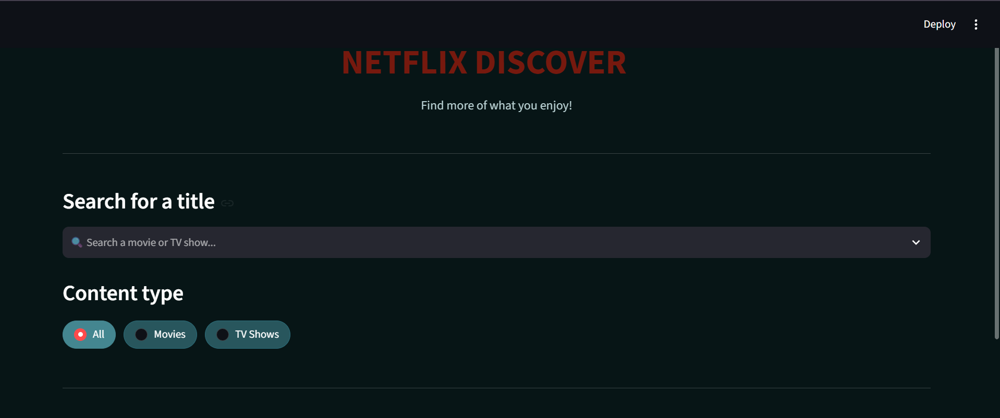
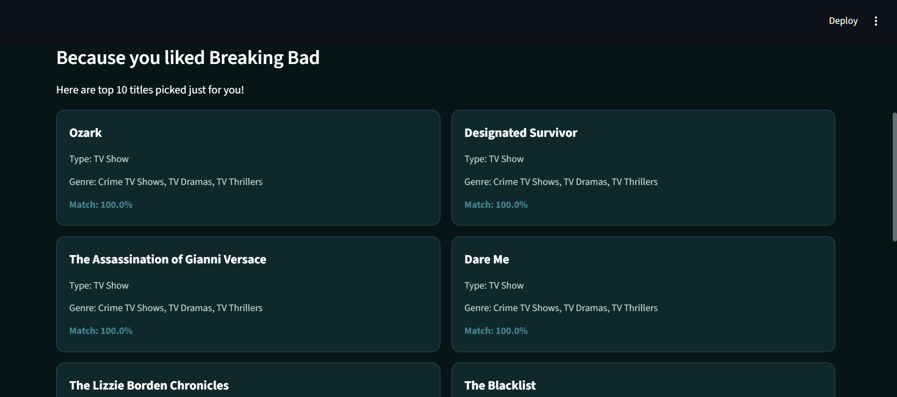
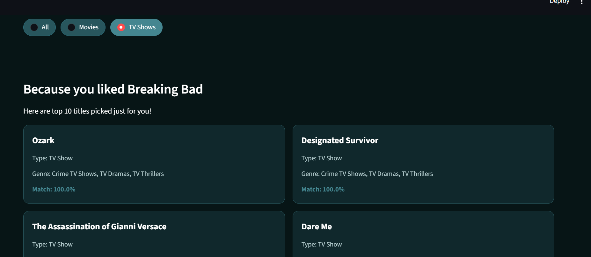
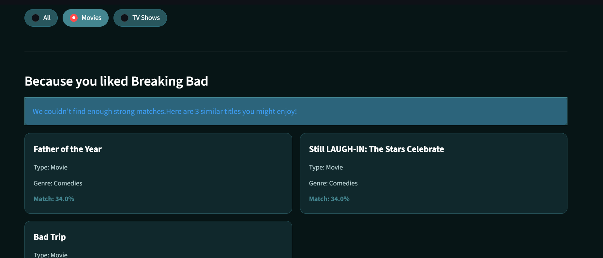

# Netflix Discover – Content Recommendation System

A content-based recommendation system that suggests movies and TV shows based on the selected title using metadata and machine learning techniques.

## About the Project

Netflix Discover is a content recommendation application developed using Python and Streamlit. It uses information such as genres, directors, countries, ratings and content types to identify titles with similar characteristics.

The application allows users to search for a movie or TV show and explore recommendations based on their selection.

## Features

- Searchable movie and TV show selection.
- Content type filtering (All, Movies, TV Shows).
- Content-based recommendations using TF-IDF.
- Cosine Similarity to calculate similarity between titles.
- Displays up to 10 recommendations with matching scores above 60%.
- Provides the three closest matches when no recommendations meet the threshold.
- Interactive interface built using Streamlit.

## Machine Learning Approach

### 1. Data Preprocessing

- Loaded and explored the Netflix dataset.
- Removed duplicate records.
- Handled missing values.
- Selected relevant metadata features such as director, country, rating, listed genres and content type.
- Combined the selected features into a single metadata field.

### 2. TF-IDF Vectorization

TF-IDF (Term Frequency-Inverse Document Frequency) converts textual metadata into numerical vectors. This allows the system to compare titles based on their content information.

### 3. Cosine Similarity

Cosine Similarity measures the similarity between the numerical vectors of two titles.

The system ranks available titles based on their similarity scores and displays the closest matches.

The similarity score is displayed as a percentage to indicate how closely the recommended title matches the selected title.

## Technologies Used

| Technology        | Purpose                         |
| ----------------- | ------------------------------- |
| Python            | Programming language            |
| Pandas            | Data preprocessing              |
| Scikit-learn      | Machine learning implementation |
| TF-IDF            | Text feature extraction         |
| Cosine Similarity | Similarity calculation          |
| Streamlit         | Web application development     |

## Dataset

The project uses a Netflix Movies and TV Shows dataset containing information about titles, genres, directors, countries, ratings, release years and content types.

## Project Structure

```text
Netflix-Recommendation-System/
│
├── app.py
├── recommendation.py
├── Dataset.csv
├── requirements.txt
├── README.md
│
└── images/
    ├── homepage.png
    ├── 10_recs.png
    ├── type_shows.png
    └── type_movie_fallback.png
```

## Installation and Execution

### 1. Clone the Repository

```bash
git clone https://github.com/dharshinimr0211-arch/netflix-content-recommendation-system.git
```

### 2. Navigate to the Project Folder

```bash
cd Netflix-Recommendation-System
```

### 3. Create a Virtual Environment

```bash
python -m venv .venv
```

### 4. Activate the Virtual Environment

For Windows:

```powershell
.venv\Scripts\activate
```

### 5. Install Dependencies

```bash
pip install -r requirements.txt
```

### 6. Run the Application

```bash
python -m streamlit run app.py
```

The application will open in your browser.

## Application Screenshots

### Homepage



### Top Recommendations



### Content Type Filtering



### Fallback Recommendations



---
